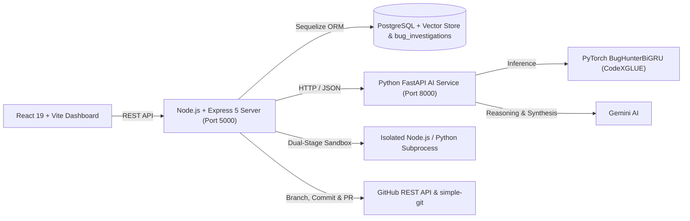

# 🐛 BugHunter AI

> An end-to-end **Autonomous AI Bug Investigation, Code RAG, ML Defect Detection, Dual-Stage Sandbox Verification & GitHub PR Automation** platform.

BugHunter AI ingests GitHub repositories, indexes source code into PostgreSQL vector embeddings for semantic Code RAG retrieval, scans snippets with a custom **PyTorch Bi-GRU ML defect detector** trained on the **CodeXGLUE** dataset, investigates root causes and synthesizes patches with LLM reasoning, verifies fixes in an **isolated dual-stage sandbox (Buggy = FAIL ➔ Patched = PASS)**, persists every investigation in PostgreSQL, and opens clean **GitHub Pull Requests** automatically.

---

## ✨ Implemented Features

- [x] **Repository Intelligence & Library** — Clone GitHub repositories (`simple-git`), analyze project structure, chunk code, generate vector embeddings, list indexed repositories, and delete stale indexes (`GET / POST / DELETE /api/repositories`).
- [x] **Semantic Code Search (Code RAG)** — Query indexed codebases using vector similarity search backed by PostgreSQL (`POST /api/search/code`).
- [x] **PyTorch Bi-GRU Defect Scanner (CodeXGLUE)** — Custom 1,330,178-parameter bidirectional GRU neural classifier (`BugHunterBiGRU`) trained on CodeXGLUE (`21,854` train / `2,732` val / `2,732` test samples) to score defect probability (`LOW` / `MEDIUM` / `HIGH`) directly in the UI (`POST /api/bugs/detect-defect`).
- [x] **AI Bug Investigation & Patch Synthesis** — Combine RAG context + repository insights to diagnose root causes, suggest minimal patches, and generate reproduction unit tests (`POST /api/bugs/investigate`, `POST /api/bugs/patch`, `POST /api/bugs/generate-test`).
- [x] **Dual-Stage Isolated Execution Sandbox** — Runs reproduction tests first on the **original buggy snippet** (expects FAIL) and then on the **AI-patched code** (expects PASS) in isolated **Node.js** (built-in Jest assertion shim with 5s timeout) and **Python** subprocesses (`POST /api/bugs/verify-patch`).
- [x] **Automated GitHub PR Pipeline** — Strips markdown code fences cleanly (`extractCleanCode`), validates GitHub PATs, generates PR summaries, creates branches, commits patched files, and opens live Pull Requests (`POST /api/github/create-pr`).
- [x] **PostgreSQL Investigation & PR History** — Persists investigations, generated patches, test verification statuses, and PR links in `bug_investigations`, allowing one-click restore or deletion from the React **History** tab (`GET / DELETE /api/bugs/history`).
- [x] **Single-Command Multi-Service Launcher** — Starts FastAPI AI service (`8000`), Express API (`5000`), and Vite React client (`5173`) together via `npm start`.

---

## 🏗️ System Architecture



---

## 🛠️ Tech Stack

| Layer | Technologies |
| :--- | :--- |
| **Frontend** | React (`^19.3.1`), Vite (`^8.3.4`), `lucide-react` |
| **Backend API** | Node.js, Express (`^5.2.1`), Sequelize (`^6.37.8`), `simple-git` (`^3.36.0`) |
| **Database** | PostgreSQL (`pg ^8.23.0`) with vector search & `bug_investigations` table |
| **AI & ML Service** | Python 3, FastAPI, Uvicorn, PyTorch (`BugHunterBiGRU`), `scikit-learn`, Gemini API |
| **Execution Sandbox** | Isolated Node.js subprocess (`assert` + Jest shim, 5s timeout) & Python subprocess (`exec`) |

---

## 📂 Project Structure

```text
BigHunter-AI/
├── package.json                     # Root launcher scripts (npm start, npm run train:ml)
├── scripts/
│   └── start-all.js                 # Zero-dependency concurrent launcher for all 3 services
├── client/                          # React + Vite Dashboard
│   └── src/
│       ├── App.jsx                  # 7-tab workspace (Investigate, Patch, Test, Repo, Search, PR, History)
│       └── App.css                  # Dashboard styles & Defect Risk Gauge UI
├── server/                          # Node.js / Express Backend
│   ├── .env.example                 # Backend DB, AI URL & GitHub env template
│   └── src/
│       ├── app.js                   # Express app & route mounting
│       ├── server.js                # Sequelize sync & HTTP entrypoint
│       ├── config/database.js       # PostgreSQL connection
│       ├── models/                  # Repository, CodeChunk, BugInvestigation
│       ├── controllers/             # bug, github, repository controllers
│       ├── routes/                  # /api/bugs, /api/github, /api/repositories, /api/search
│       └── services/                # RAG, code indexer, sandbox runner, GitHub PR automation
└── ai-service/                      # Python FastAPI + PyTorch Service
    ├── .env.example                 # GEMINI_API_KEY template
    ├── requirements.txt             # FastAPI, PyTorch, scikit-learn dependencies
    ├── app/
    │   ├── main.py                  # FastAPI endpoints & sandbox execution engine
    │   └── defect_model.py          # PyTorch BugHunterBiGRU loader & predictor
    ├── datasets/codexglue/          # CodeXGLUE train/valid/test JSONL splits
    └── training/
        ├── train_defect_detector.py # PyTorch Bi-GRU training & evaluation script
        └── artifacts/               # Saved defect_detector.pt checkpoint & test_metrics.json
```

---

## 🔌 Core API Reference

### Node.js Backend (`http://localhost:5000`)

| Endpoint | Description |
| :--- | :--- |
| `GET /api/health` | Backend health check |
| `GET /api/repositories` | List all indexed repositories |
| `POST /api/repositories/analyze` | Clone, chunk, embed, and store a GitHub repository |
| `DELETE /api/repositories/:id` | Delete an indexed repository |
| `POST /api/search/code` | Semantic Code RAG similarity search |
| `POST /api/bugs/detect-defect` | Run PyTorch Bi-GRU ML defect probability scan |
| `GET /api/bugs/defect-model-info` | Fetch trained model architecture & CodeXGLUE test metrics |
| `POST /api/bugs/investigate` | Investigate bug root cause & save record to PostgreSQL |
| `POST /api/bugs/patch` | Generate targeted minimal patch |
| `POST /api/bugs/generate-test` / `/test` | Generate reproduction unit test |
| `POST /api/bugs/verify-patch` | Run dual-stage sandbox verification (Buggy FAIL ➔ Patched PASS) |
| `GET /api/bugs/history` | List persisted bug investigations & PR links |
| `DELETE /api/bugs/history/:id` | Delete an investigation history item |
| `POST /api/github/validate-token` | Validate GitHub Personal Access Token |
| `POST /api/github/generate-pr-summary` | Generate AI-written PR title and summary |
| `POST /api/github/create-pr` | Create branch, commit clean patched file, open PR & update history |

### Python AI Service (`http://127.0.0.1:8000`)

- `GET /health` — Service & model readiness status (`defect_model_loaded`)
- `POST /embed` — Generate code embeddings
- `GET /defect-model-info` & `POST /detect-defect` — Bi-GRU defect metadata and inference
- `POST /analyze-bug`, `POST /generate-patch`, `POST /generate-test`, `POST /generate-pr-description`
- `POST /synthesize-verification` & `POST /execute-python-sandbox`

---

## 🚀 Local Setup & Running

### 1. Prerequisites
- **Node.js** (v18+) & **npm**
- **Python** (3.10+)
- **PostgreSQL** (with vector support enabled for Code RAG embeddings)

### 2. Configure Environment Variables

Copy templates and fill in your credentials:

```bash
cp server/.env.example server/.env
cp ai-service/.env.example ai-service/.env
```

- `server/.env`: `PORT=5000`, `DB_HOST`, `DB_PORT`, `DB_NAME`, `DB_USER`, `DB_PASSWORD`, `AI_SERVICE_URL=http://127.0.0.1:8000`, `GITHUB_TOKEN` (optional default PAT)
- `ai-service/.env`: `GEMINI_API_KEY`

### 3. Install Dependencies

```bash
cd server && npm install
cd ../client && npm install
cd ../ai-service && pip install -r requirements.txt
```

### 4. (Optional) Train / Refresh the PyTorch Bi-GRU Model

```bash
npm run train:ml
```

*(Supports optional `BH_EPOCHS` and `BH_BATCH_SIZE` environment overrides to control CPU training time.)*

### 5. Launch the Entire Platform

From the repository root:

```bash
npm start
```

This concurrently starts:
1. **AI Service** (`http://127.0.0.1:8000`)
2. **Express API** (`http://localhost:5000`)
3. **React + Vite Dashboard** (`http://localhost:5173`)
